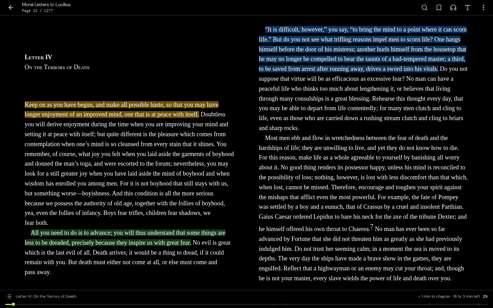
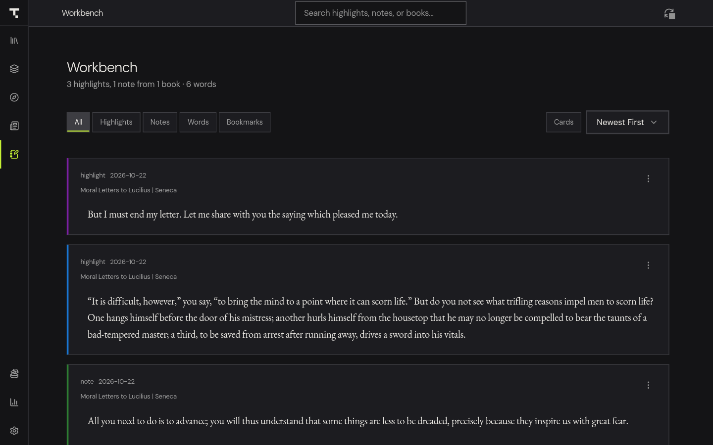
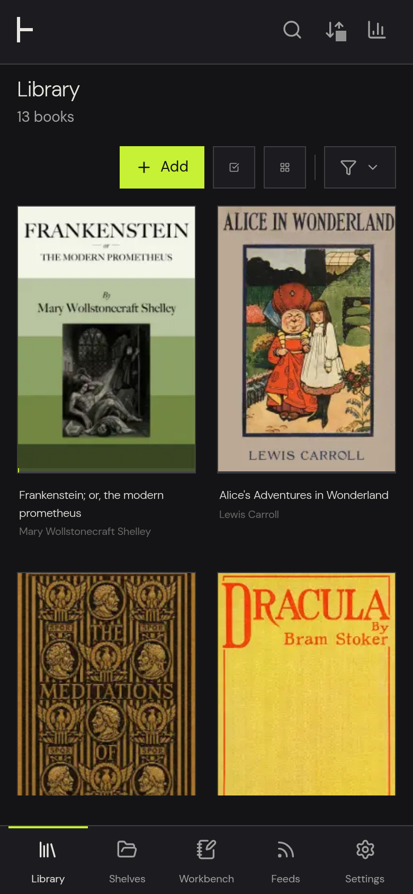
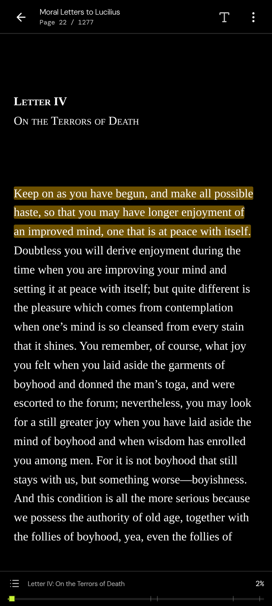
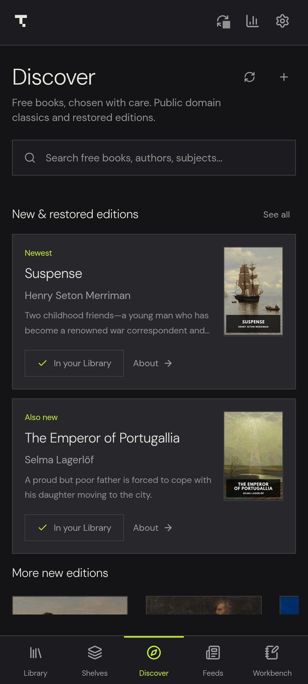
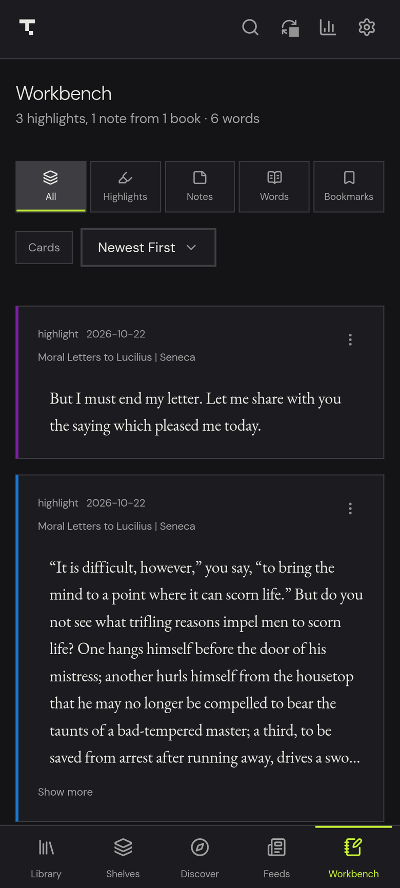
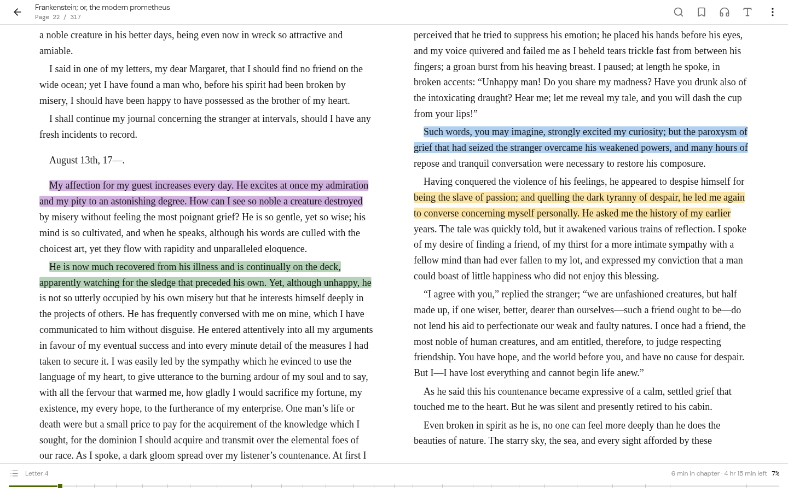
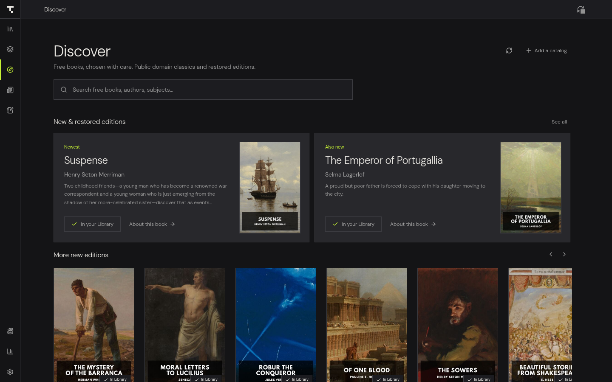
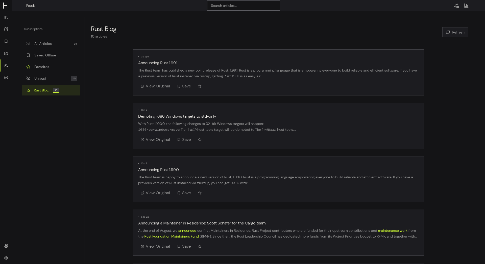

<p align="center">
  
</p>

<h1 align="center">Theorem</h1>

<p align="center">
  <strong>A local-first ebook, PDF and RSS reader that writes your highlights to Markdown.</strong><br>
  Free, open source, no account. Linux, macOS, Windows and Android.
</p>

<p align="center">
  <a href="https://read.fundaments.work"></a>
  <a href="https://github.com/fundaments-work/theorem/releases"></a>
  <a href="https://github.com/fundaments-work/theorem/releases"></a>
</p>

<p align="center">
  <a href="./LICENSE"></a>
  <a href="https://github.com/fundaments-work/theorem/releases"></a>
  <a href="https://github.com/fundaments-work/theorem/actions"></a>
  <a href="./CONTRIBUTING.md"></a>
</p>

<p align="center">
  <a href="#quick-install">Install</a> ·
  <a href="https://read.fundaments.work">Web demo</a> ·
  <a href="https://theorem.fundaments.work">Website</a> ·
  <a href="https://fundaments.work/docs/theorem/">Docs</a> ·
  <a href="https://fundaments.work/docs/theorem/guide/highlights-to-obsidian/">Highlights to Obsidian</a> ·
  <a href="#features">Features</a> ·
  <a href="#faq">FAQ</a> ·
  <a href="./CONTRIBUTING.md">Contribute</a>
</p>

<p align="center">
  
</p>

**Theorem** is a free, open-source **ebook reader, PDF reader and RSS reader** for **Linux, macOS, Windows and Android**, built on one TypeScript and Rust codebase. Read DRM-free EPUB, PDF, MOBI, AZW, FB2, CBZ and CBR files and your feeds in one workspace. Highlight in six colors, add notes, look words up in offline dictionaries, and listen with neural text-to-speech. Every highlight and note exports to plain **Markdown for Obsidian and Logseq**, so your reading data is yours.

**No cloud account. No subscription wall. No vendor lock-in.**

<table>
  <tr>
    <td width="50%"></td>
    <td width="50%"></td>
  </tr>
  <tr>
    <td align="center"><sub><b>Library</b> — covers, shelves, series, search and filters</sub></td>
    <td align="center"><sub><b>Workbench</b> — every highlight and note, ready to export to Markdown</sub></td>
  </tr>
</table>

<p align="center">
  
  
  
  
</p>

---

## Quick Install

### Linux (one command)

```bash
# Latest stable release
curl -fsSL https://raw.githubusercontent.com/fundaments-work/Theorem/main/scripts/install-linux.sh | bash

# Latest beta / pre-release
curl -fsSL https://raw.githubusercontent.com/fundaments-work/Theorem/main/scripts/install-linux.sh | bash -s -- --beta

# Or install a specific version
curl -fsSL https://raw.githubusercontent.com/fundaments-work/Theorem/main/scripts/install-linux.sh | bash -s -- --version 1.5.4
```

### Manual Download

| Platform | Format |
|----------|--------|
| Linux | `.deb` or `.AppImage` |
| macOS (Intel) | `.dmg` |
| macOS (Apple Silicon) | `.dmg` |
| Windows | `.exe` (NSIS) or `.msi` |
| Android | `.apk` |

All builds on the [Releases page](https://github.com/fundaments-work/theorem/releases). Website and docs at [theorem.fundaments.work](https://theorem.fundaments.work). Try the [web demo](https://read.fundaments.work) without installing.

---

New to Theorem? Read the [user guide](docs/user/index.md), or see [everything it can do](docs/user/features.md).

## Quick Start (Development)

```bash
git clone --recurse-submodules https://github.com/fundaments-work/theorem.git
cd theorem
pnpm install

pnpm dev          # Web dev server (http://localhost:1420)
pnpm dev:tauri    # Desktop app in dev mode
```

**Prerequisites**: Node.js 22+, pnpm 10+, Rust (via [rustup](https://rustup.rs)), and [Tauri system deps](https://tauri.app/start/prerequisites/).

| Command | Description |
|---------|-------------|
| `pnpm dev` | Start Vite dev server |
| `pnpm dev:tauri` | Start Tauri desktop app |
| `pnpm build` | Typecheck + production build |
| `pnpm typecheck` | TypeScript type checking |
| `pnpm test` | Run Vitest unit tests |
| `pnpm package:linux` | Build Linux release package |

See [AGENTS.md](./AGENTS.md) for the full repository map, conventions, and architecture.

---

## Features

### Multi-Format Reader & Instant Opening
EPUB, MOBI, AZW, AZW3, FB2, FBZ, CBZ, CBR, PDF, and RSS articles (DRM-free files only). In the desktop and Android apps, a Rust pre-reader unpacks the EPUB's table of contents, stylesheets, and first chapters while the reader starts up, so big EPUBs open without a wait. Search inside any book without freezing the page. Foliate-based reflowable rendering with paged and scroll modes. PDF.js engine with zoom (25–500%), page-fit/width-fit modes, and outline navigation. **Theorem Lens** (in-place footnote and citation peeks, plus figures and tables in PDFs, without losing your reading place). Full table of contents with section progress. Estimated reading time per page and chapter. Reading progress saved per-book across sessions (page-accurate + CFI). File association — open ebooks directly from your file manager.

<p align="center">
  
</p>

### Discover & OPDS Catalogs

<p align="center">
  
</p>

Discover is a front page for free books, curated on our server: full-text search over 78,000+ public domain classics, the newest Standard Ebooks editions, hand-picked shelves and subjects, recent searches, and 1-click downloads. Add your school, university or library catalog, or any **OPDS catalog** (Calibre, Kavita, Komga, COPS), and it appears as a tab: OPDS 1.x and **OPDS 2.0**, sections and shelves, server search, sort/language/format filters, series and covers, and books that load as you scroll. Catalogs that need a login sign in with HTTP Basic (kept on your device only). Purchases, loans and DRM-locked files are explained rather than faked. Everything downloads through the same import as "Add Books". Works on phones, too (Discover is a bottom-bar tab). One Rust parser serves the desktop, Android and web builds.

### Reading Customization
Three reader themes: Light, Sepia, Dark. Font family (original, serif, sans-serif, monospace). Font size (12–32), line height (1.0–2.2). Text alignment. Reading flow (paged, scroll). Brightness slider. Zoom for fixed-layout formats. Full-screen mode. Tap to hide the toolbars.

### Highlights & Annotations
Six color-coded highlight colors: yellow, green, blue, red, orange, purple. Notes on any highlight. A highlight that runs across a page break is always one highlight (overlapping or touching selections merge). Bookmarks (a Workbench tab, on phones too). Annotation panel with quick navigation, editing, and deletion. Works across all formats including PDF and RSS articles.

### PDF Annotations
Freehand drawing with configurable stroke width. Text notes placed anywhere on the page. Multi-line rectangular highlights. Per-page annotation rendering. PDF view state persistence (page, zoom, mode per-book).

### Highlight Sharing
Generate polished share-card images from any highlight. Multiple formats: Square (1080×1080) and Story (1080×1920). Multiple visual themes: match, dark, tinted, sepia. Download as PNG, native share via Web Share API, share to X (Twitter). Android: saves to MediaStore gallery.

### Text-to-Speech & Neural Voice (Immersion Reading)
Platform-native TTS with zero setup — Android TextToSpeech, Linux speech-dispatcher (spd-say), macOS `say`, Windows PowerShell System.Speech — plus an optional offline **neural voice** (Supertonic 3, fp32) on desktop: ~400MB of ONNX models downloaded on demand and SHA-256-verified (nothing ships in the app), 10 voices, 31 languages, with cached synthesis and next-chunk prefetch for a continuous audiobook feel. On Android, neural narration comes from the installable Theorem Neural Voice companion TTS engine. Attach a human-narrated `.m4b`/`.mp3` to any book to upgrade immersion mode into a full audiobook player (chapters, speed, sleep timer, lock-screen controls), or generate an audiobook from an open book in one click (Ogg Opus, desktop).

### Vocabulary Builder & Native Dictionary Engines
Look up words while reading with instant offline definitions. Two native memory-mapped (`memmap2`) engines: **StarDict** (`.ifo`/`.idx`/`.dict.dz` with DictZip auto-inflation and part-of-speech structuring) and **MDict `.mdx`** (keyword-index binary search, zlib block cache, cross-references). Lookups read directly from disk. Download English Wiktionary (1.35 million words) with 1-click from settings or import custom dictionary files. Online API fallback with audio pronunciations. Dedicated vocabulary capture and review workspace.

<p align="center">
  
</p>

### RSS Reader & Native Web Extractor
Subscribe to feeds with full annotation tools. Native Rust article fetcher and readability cleaner extracts clean text, OpenGraph metadata, and images while stripping ads, scripts, and clutter with zero IPC bloat. Feed discovery from web pages. Articles stored in dedicated SQLite tables with a configurable retention policy (Keep Forever / 15–90 days) that protects unread and offline-saved items. Per-feed unread count. Favoriting.

<p align="center">
  
</p>

### Markdown Export (Obsidian / Logseq)
Export highlights and annotations to local Markdown files. Designed for vault-based PKM workflows. Per-book Markdown pages with YAML frontmatter. Vocabulary export with definitions and phonetics, plus spaced-repetition **Lemma flashcards**. Automatic vault export runs on desktop; highlights made on Android reach your vault after syncing to a desktop. Customizable file naming. Highlights group **By Chapter (hierarchical)** by default, or flat chronological. Presets for Obsidian, Logseq, Minimalist, or a **Custom KNAP template** with live editor and preview. One-click export.

### Library Management & Parallel Batch Ingestion
On desktop, a multithreaded Rust batch ingestion pipeline (`rayon` + `quick-xml` + `image`) imports hundreds of books at once with SHA-256 deduplication and native cover extraction. Custom collections / shelves. Favorites toggle with dedicated section. Book ratings (1–5 stars). Tags and categories. Multiple view modes: grid, list, compact. Sort by title, author, date added, or last read. Library search by title, author, or tags.

Folder imports can **preserve the original folder hierarchy** with a built-in source-folder browser (breadcrumbs, filtering), or flatten on import. **Nested sub-shelves** organize large libraries one level deep. **Smart shelves** auto-populate from native filter rules — author, series, tag, category, format, reading status, favorite — with AND/OR logic, recomputed as the library changes. **Book series** carry a series name and fractional volume index (`2.5` supported), read from EPUB metadata or `ComicInfo.xml`; shelves can group by series with combined progress, and finishing a volume surfaces the next unread one. **Bulk selection** selects every book matching the current filters (not just visible rows), clears on filter changes, and offers dynamic read/unread toggles with 1-click Undo.

<p align="center">
  
</p>

### Comics
CBZ and **CBR** open natively everywhere — the RAR container is decoded in pure Rust (`rars`) straight into a stored ZIP, so no external `unrar` binary is needed on any platform including Android. A **continuous vertical strip** mode renders comics as one touch-responsive scrolling column with bounded image loading, eliminating page turns for webtoons.

### Reading Statistics
Reading time tracking (total and per-book). Books finished. Reading streaks: current + longest. Daily activity log with 12-week heatmap. Reading goals: daily minutes and yearly books. Book completion tracking. Achievements. Shareable stats card. OS notifications for goal completion and a scheduled daily reminder.

### Speed Reader
RSVP rapid-serial-visual-reading overlay with optimal-recognition-point highlighting, play/pause, and auto-advance — for skimming when full narration is too slow.

### Terminal CLI & TUI
Desktop builds ship a headless `theorem` command (`clap`) with 18 commands — `search`, `read`, `dict`, `extract`, `library`, `shelf`, `highlights`, `bookmarks`, `feeds`, `opds`, `sync`, `storage`, `stats`, `export`, `open`, and more — supporting `--json`, stable exit codes, and TTY-aware color. A read-only `ratatui` TUI browses the library and reads chapters as plain text. Scriptable, and compiled out of the Android build to keep the APK lean.

### Desktop Shell
System tray with Show / Sync Now / Quit, hide-to-tray, remembered window geometry, multi-window reading, native print dialog, and OS file associations.

### LAN Device Sync
Encrypted peer-to-peer sync between Theorem installs. Syncs books, reading progress, annotations, collections, settings, and vocabulary. QR-based device pairing (camera scan on Android) or pairing codes. Device identity management with public-key encryption. Auto-sync on peer discovery. Periodic background sync. Deletion tombstones prevent removed items from reappearing when an offline peer reconnects. Devices sync directly on your network; when they can't, an end-to-end encrypted relay passes data it cannot read. No account, no Theorem server.

### Remote Announcements
Project updates, advisories, and release notes delivered to every install from a dedicated edge Worker — rendered through a strict zero-HTML linkifier, cached for 24 hours, dismissible, and never shown while reading.

### Backup & Data Management
Export your data as one JSON file: library (book metadata, collections, annotations), settings, statistics, vocabulary, and RSS feeds. Book files are not included and there is no in-app restore yet. Storage usage breakdown. Cache size configuration.

### Cross-Platform
Desktop: Linux (.deb, .AppImage), macOS Intel + Apple Silicon (.dmg), Windows (.exe NSIS, .msi). Mobile: Android (.apk). Web: browser fallback for development. All from a single TypeScript + Rust codebase.

---

## Tech Stack

| Layer | Technology |
|-------|------------|
| Frontend | React 19, TypeScript, Vite 8 |
| State | Zustand 5 (persisted + versioned migrations) |
| Styling | Tailwind CSS v4, CSS design tokens |
| Desktop | Tauri 2 (Rust) |
| Mobile | Tauri 2 Android |
| PDF | PDF.js 6 |
| Ebook | Foliate.js (vendored) |
| TTS | Platform native (Android TTS, spd-say, say, System.Speech) + optional Supertonic 3 neural voice on desktop (ONNX via ort, downloaded on demand) |
| Dictionary | StarDict + MDict (native, memory-mapped) |
| RSS | Native Rust extractor (Mozilla Readability browser fallback) |
| Archive | zip.js (vendored in the Foliate runtime), `rars` (pure-Rust RAR for CBR), fflate (browser EPUB write fallback) |
| Testing | Vitest + jsdom |

---

## Why Theorem?

Built for **knowledge workers** who want to own their reading data:

- **Your data stays local** — everything on your device. No account, no tracking, no data mining.
- **Portable by design** — exports are plain Markdown files. Move to any tool anytime.
- **True offline-first** — works completely without internet. Sync when you choose.
- **No subscriptions** — free and open-source. Always.

### Is Theorem a Readwise alternative?

Yes. Local-first reading, annotation, and Markdown export without a paid subscription. Plus: ebook reader, RSS reader, vocabulary builder, neural TTS, peer-to-peer sync, and highlight sharing — all in one app.

---

## FAQ

**Is my data safe?** — Yes. Everything is stored locally. No cloud account required.

**Can I migrate away?** — Yes. Exports are plain Markdown files, portable to any tool.

**Does it work with Obsidian and Logseq?** — Yes. Markdown sync is designed for vault-based workflows.

**Is there device sync?** — Yes. Encrypted peer-to-peer pairing between Theorem installs: direct on your network, otherwise through an encrypted relay that can't read your data. No account needed.

**Does TTS work offline?** — Yes. Platform TTS uses your system's built-in engine with no downloads. The optional desktop neural voice is also fully offline after its one-time model download. Audiobook playback and Save-as-Audiobook (desktop) are offline too.

**What formats are supported?** — EPUB, MOBI, AZW, AZW3, FB2, FBZ, CBZ, CBR, PDF, and RSS feeds.

**Can I try it without installing?** — Yes. The [web demo](https://read.fundaments.work) runs in your browser.

**Why MIT instead of AGPL?** — MIT lets anyone use, modify, and integrate the code without forcing them to open-source their changes. For a local-first reading app that stores all data as plain Markdown, the protection AGPL offers is unnecessary — your data is already portable.

---

## Contributing

See [CONTRIBUTING.md](./CONTRIBUTING.md) for guidelines, code conventions, and the pull request process.

**Design.** Theorem uses the [Fundaments.work design system](https://github.com/Fundaments-Work/design-system) unchanged: square corners, DM Sans and DM Mono at two weights, one dark base and one lime accent. It has no design system of its own.

---

## License

MIT License — see [LICENSE](./LICENSE) for details.

The Theorem™ name and logo are not covered by the MIT License. See [TRADEMARKS.md](./TRADEMARKS.md) for how to use them, and how to name a fork.
