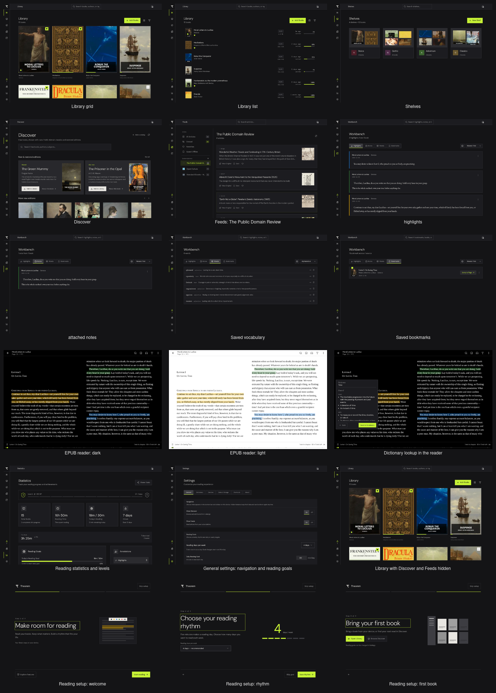
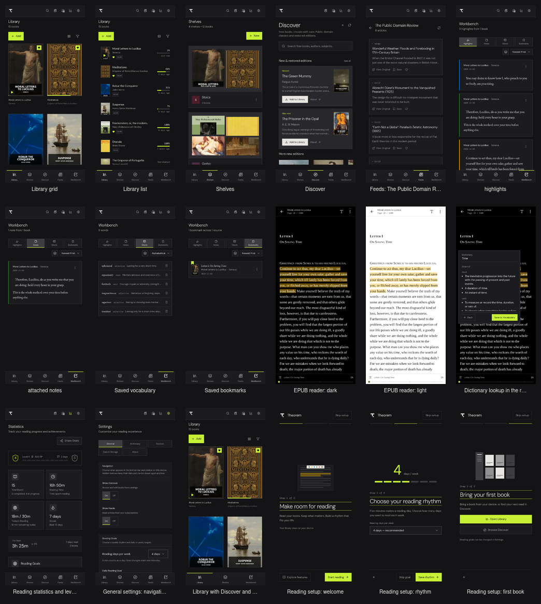

# Theorem 1.6.1 screenshots

Captured from commit `b8d2e257`. These are genuine app captures with staged public-domain books, live feed subscriptions, highlights, vocabulary and sample reading history. Phone images show the responsive browser interface; they are not Android OS screenshots.

## Placement

Desktop assets are 1440 × 900. Phone assets are 1082 × 2402. The landing exports in theorem-landing/public/images use 1920 × 1048 with 960px WebP variants. Use the separate phone files when arranging device frames; the landing also has a four-phone composite.

| Screen | Desktop | Phone |
|---|---|---|
| Library grid | [PNG](library-grid.png) | [PNG](mobile-library.png) |
| Library list | [PNG](library-list.png) | [PNG](mobile-library-list.png) |
| Shelves | [PNG](shelves-overview.png) | [PNG](mobile-shelves-overview.png) |
| Discover | [PNG](discover.png) | [PNG](mobile-discover.png) |
| Feeds: The Public Domain Review | [PNG](feeds-reader.png) | [PNG](mobile-feeds-reader.png) |
| Workbench highlights | [PNG](workbench-highlights.png) | [PNG](mobile-workbench.png) |
| Workbench attached notes | [PNG](workbench-notes.png) | [PNG](mobile-workbench-notes.png) |
| Saved vocabulary | [PNG](workbench-words.png) | [PNG](mobile-workbench-words.png) |
| Saved bookmarks | [PNG](workbench-bookmarks.png) | [PNG](mobile-workbench-bookmarks.png) |
| EPUB reader: dark | [PNG](reader-dark-highlights.png) | [PNG](mobile-reader.png) |
| EPUB reader: light | [PNG](reader-light-highlights.png) | [PNG](mobile-reader-light-highlights.png) |
| Dictionary lookup in the reader | [PNG](dictionary-lookup.png) | [PNG](mobile-dictionary-lookup.png) |
| Reading statistics and levels | [PNG](statistics.png) | [PNG](mobile-statistics.png) |
| General settings: navigation and reading goals | [PNG](settings-navigation.png) | [PNG](mobile-settings-navigation.png) |
| Library with Discover and Feeds hidden | [PNG](minimal-navigation.png) | [PNG](mobile-minimal-navigation.png) |
| Reading setup: welcome | [PNG](onboarding-welcome.png) | [PNG](mobile-onboarding-welcome.png) |
| Reading setup: rhythm | [PNG](onboarding-rhythm.png) | [PNG](mobile-onboarding-rhythm.png) |
| Reading setup: first book | [PNG](onboarding-library.png) | [PNG](mobile-onboarding-library.png) |

## Capture and sources

The private fundaments-agent-harness repo owns screenshots/theorem/capture.sh and publish.sh. Captures and downloaded books stay in the harness state directory; only reviewed images and this placement guide belong in product repos. manifest.json records the source commit, viewport sizes, book editions and feed URLs. Reading history is sample data, evaluated by the same Rust/WASM rules as the app.

Books: [Standard Ebooks](https://standardebooks.org/) and [Project Gutenberg](https://www.gutenberg.org/). Feeds: [The Public Domain Review](https://publicdomainreview.org/), [Open Culture](https://www.openculture.com/) and [Standard Ebooks](https://standardebooks.org/). Dictionary lookup uses a cached real [Free Dictionary API](https://api.dictionaryapi.dev/api/v2/entries/en/time) response from [Wiktionary](https://en.wiktionary.org/wiki/time), licensed [CC BY-SA 3.0](https://creativecommons.org/licenses/by-sa/3.0/); no installed dictionary is simulated. The reader shows Seneca’s *Moral Letters to Lucilius*, Letter I, “On Saving Time”.
