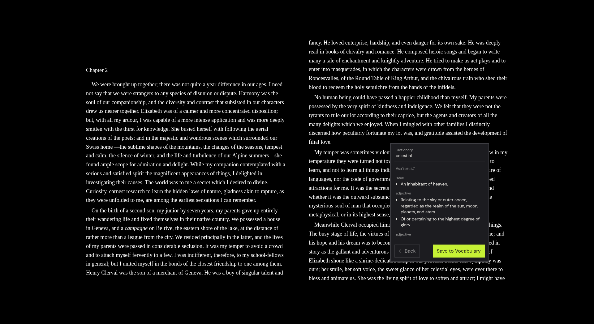

# Dictionary and Vocabulary

Look up words while you read, install offline dictionaries, and save the words you want to remember to a vocabulary list that can also be exported.

## Look up a word

1. In the reader, select a word. This works in books, PDFs and RSS articles.
2. In the pop-up that appears, click Define.
3. Read the definition. It shows the word, its phonetic spelling when one is available, and its meanings grouped by part of speech.
4. Click a linked word inside a definition, if there is one, to look that word up. Click Back to return to the previous entry.
5. Click Save to Vocabulary to keep the word. The button changes to Saved.

If Theorem finds nothing, the pop-up says "No definition found."

Define is also in the pop-up that appears when you click an existing highlight. See [Highlights and notes](highlights-and-notes.md).

### Where definitions come from

Theorem first looks in the dictionaries installed on your device. Offline lookups are instant and need no network. If no installed dictionary has the word, or none is installed, Theorem asks an online dictionary service, [dictionaryapi.dev](https://dictionaryapi.dev/), for the word. That request sends the word you selected over the internet. Install an offline dictionary if you want lookups to stay on your device.

## Install an offline dictionary

Theorem reads two dictionary formats: StarDict and MDict (`.mdx`).

### Download a dictionary

1. Open Settings and select the Dictionary tab.
2. Under Installed Dictionaries, click Download Dictionary.
3. Choose English Wiktionary as MDict (`.mdx`), about 154 MB, or as StarDict (`.zip`), about 127 MB. Both hold about 1.35 million words.
4. Wait for the download to finish. A progress indicator shows the transfer, and you can cancel it.

### Import your own StarDict files

1. Open Settings, select the Dictionary tab, and under Installed Dictionaries click Import Files.
2. Select all the files of one StarDict dictionary at the same time. A StarDict dictionary is a set of files such as `.ifo`, `.idx`, `.dict` or `.dict.dz`, and optionally `.syn`.
3. Click Open.

The import button is set up for StarDict file types. To add an MDict dictionary, use Download Dictionary.

### Check and remove dictionaries

The Installed Dictionaries list shows each dictionary's name, language, format (StarDict or MDict) and size. Click Remove next to a dictionary and confirm to delete it. Settings also shows the total size of your offline dictionaries on the Data & Storage tab.

## Dictionary settings

On the Dictionary tab, turn Show Pronunciation on or off to show or hide the phonetic spelling. On the General tab, turn Vocabulary Lookup on or off. When it is off, the pop-up cannot save words and says "Enable Vocabulary Builder in Settings to save terms."

## Review and export your vocabulary

- **In the app.** Open the Workbench and select the Words tab. Click a word to see its definitions, or choose Delete this term to remove it. See [Workbench and bookmarks](workbench.md#review-saved-words).
- **As Markdown.** In the desktop app, saved words are written to `Vocabulary.md` in your export folder. See [Markdown export for Obsidian and Logseq](vault-sync.md#vocabulary-file).
- **On other devices.** Vocabulary is included in [device sync](device-sync.md).
