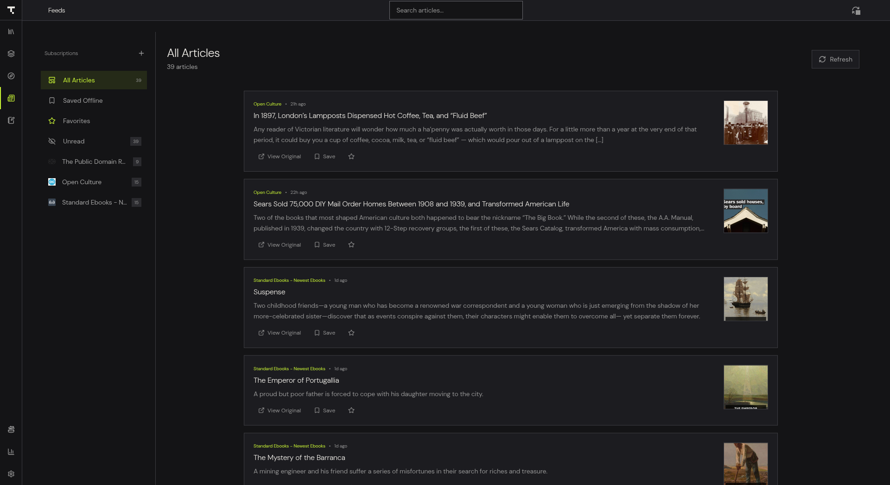

# Feeds and Articles

Subscribe to RSS and Atom feeds, read articles in the same reader as your books, save them for offline reading, and choose how long they are kept.

## Open the Feeds page

Click Feeds in the sidebar (the fourth icon), or press `Ctrl+4`. On Android, Feeds is in the bottom bar.

## Subscribe to a feed

1. On the Feeds page, click the plus button next to Subscriptions (Add Feed). If you have no feeds yet, click Add First Feed.
2. In the Add Feed window, enter the feed address under Feed URL, for example `https://example.com/feed.xml`.
3. Click Subscribe.

Theorem accepts RSS, Atom and JSON Feed addresses. If you enter the address of a web page instead of a feed, Theorem looks in the page for a feed link and uses it. Feeds are fetched from your device. If the address cannot be read, the window shows an error message and you can correct the address and try again.

## Browse your articles

The list on the left has four views:

- **All Articles** shows everything.
- **Saved Offline** shows articles you saved.
- **Favorites** shows articles you starred.
- **Unread** shows articles you have not read.

Below them is each feed, with a count of its unread articles. Click a feed to show only its articles. The search box at the top searches your articles.

Click Refresh in the page header to fetch new articles for the selected feed, or for all feeds when no single feed is selected. Each feed in the list also has its own refresh button. Refresh is manual, so click it when you want new items.

## Read an article

1. Click an article card, or right-click it and choose Read Article.
2. Theorem fetches the full article from the website, removes ads, scripts and clutter, and shows clean text in the reader. If it cannot extract the page, it shows the summary from the feed instead.
3. Use the reader as you would for a book. Highlights, notes and bookmarks all work on articles, and they appear in the Workbench and in your Markdown export. See [Highlights and notes](highlights-and-notes.md).

Each article card also has buttons:

- **View Original** opens the article's page in your browser.
- **Save** keeps the article for offline reading.
- The star adds it to your favorites.

Right-click an article for more: Read Article, Save Offline or Remove from Saved Offline, Add to Favorites or Remove from Favorites, Open Original, Copy Link, Mark Read or Mark Unread, and Delete Article.

To remove a feed, click the Remove feed button next to it in the list.

## Choose how long articles are kept

1. Open Settings and select the General tab.
2. Find RSS & Articles Retention.
3. Set Article Retention Period to Keep Forever, 15 days, 30 days (the default), 60 days or 90 days. Theorem deletes read articles that you have not favorited once they are older than this, along with their cached content.
4. Leave Keep Unread Articles on (the default) to keep unread articles no matter how old they are.

Articles you saved with Save or Save Offline are always kept, whatever the retention setting.
