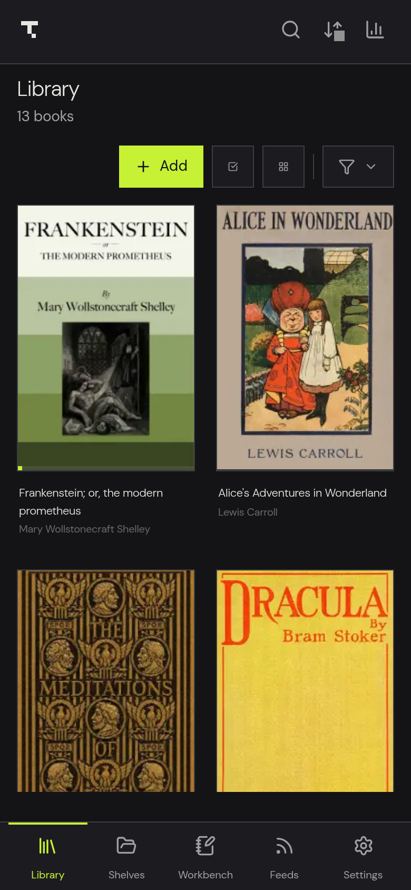

# Getting Started

Open Theorem for the first time, add your first book, and learn how the sidebar, top bar and search box work on desktop and on Android phones and tablets.

## First launch

The first time you start Theorem, a short welcome flow explains the main ideas in five screens: Welcome, Read Anything, Highlight and Annotate, Organize Your Library, and Sync Across Devices.

1. Click Next to move through the screens, or click Back to return to the previous one. You can also click the dots at the bottom to jump to a screen.
2. Click Skip in the top-right corner to leave the flow at any time.
3. On the last screen, click Get Started.

The flow appears only once. Your library is empty until you add books.

## Add your first book

1. Open the Library page. It is the first icon in the sidebar.
2. Click Add Books.
3. In the file picker, select one or more book files and confirm. Theorem accepts EPUB, MOBI, AZW, AZW3, FB2, FBZ, PDF, CBZ and CBR files.
4. Wait for the covers to appear in the library.
5. Click a cover to open the book.

Theorem works with DRM-free files only. It makes its own copy of each book in its app data folder, so your original file can stay where it is. If you import the same file twice, Theorem recognizes it by its contents and keeps only the first copy. To import a whole folder, see [Library and import](library-and-import.md#import-a-folder).

You can also open a book directly from your file manager. Theorem registers itself as a viewer for these file types, so double-clicking an EPUB, MOBI, AZW, AZW3, FB2, CBZ, CBR or PDF file can open it in Theorem. Which program opens by default depends on your operating system settings.

## Learn the layout on desktop

- **Sidebar.** A narrow icon rail on the left. Hover over an icon to see its name. From top to bottom the pages are Library, Workbench, Shelves, Feeds and Discover (Bookmarks is a tab inside Workbench; the Workbench icon stays lit on it). Settings is at the bottom. The feeds icon is labeled Snapshots in its tooltip, but it opens the Feeds page. A flame icon with a number appears above Settings when you have a reading streak.
- **Top bar.** Shows the current page name and a search box. Two icons sit on the right: Sync devices and Statistics.
- **Search box.** Searches the page you are on. On Library it reads "Search books, authors, or tags...". On Workbench it searches highlights, notes and books. On Feeds it searches articles. Press `Ctrl+F` to jump to it.
- **Page toolbar.** Library has Add Books, Select, a view button, Scan and Filter. Other pages have their own buttons.

## Learn the layout on Android

On a phone, a bottom bar gives quick access to five pages: Library, Shelves, Discover, Workbench and Feeds. The top bar has a search button, Sync devices, Statistics and Settings. Bookmarks is a tab inside Workbench, next to All, Highlights, Notes and Words. On a narrow screen only the tab you are on shows its name and the others show an icon. The full sidebar appears on wider screens such as tablets.

## Open the main pages from the keyboard

| Shortcut | Opens |
| :--- | :--- |
| `Ctrl+1` | Library |
| `Ctrl+2` | Shelves |
| `Ctrl+3` | Feeds |
| `Ctrl+4` | Workbench |
| `Ctrl+5` | Statistics |
| `Ctrl+6` | Discover |
| `Ctrl+7` | Bookmarks |
| `Ctrl+,` | Settings |

On a Mac, use the Command key instead of Control: `⌘1`, `⌘2` and so on. This guide writes `Ctrl` for the main shortcut key on every computer. The shortcuts window (`Shift+?`) and Settings show the keys for your computer. See [Settings and shortcuts](settings-and-shortcuts.md) for the full list.

## What to do next

- Read how to organize a large collection in [Library and import](library-and-import.md).
- Learn the reader in [Reading books, PDFs and comics](reading.md).
- Set an export folder to get your highlights as Markdown in [Markdown export for Obsidian and Logseq](vault-sync.md).
- Connect your phone and computer with [Sync between devices](device-sync.md).
