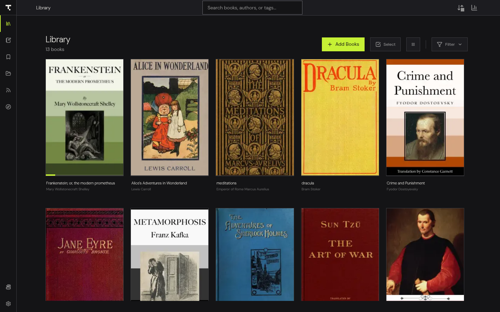

# Theorem User Guide

Theorem is a free, local-first reader for ebooks, PDFs, comics and RSS feeds that exports your highlights to Markdown, on Linux, macOS, Windows and Android.

Download Theorem from [theorem.fundaments.work](https://theorem.fundaments.work/) or the [latest release](https://github.com/Fundaments-Work/Theorem/releases/latest). [Install Theorem](install.md) lists the files for each system.

Theorem keeps your library, highlights, notes and reading progress on your own device. There is no account to create and no cloud service to sign in to. You can read DRM-free EPUB, MOBI, AZW, AZW3, FB2, PDF, CBZ and CBR files, follow RSS feeds, look words up in offline dictionaries, listen with text-to-speech, and write every highlight to plain Markdown files for Obsidian or Logseq.

## Where to start

1. If you have not installed Theorem yet, read [Install Theorem](install.md).
2. If you have just opened Theorem for the first time, read [Getting started](getting-started.md) to add a book and learn the layout.
3. If you want to start reading, go to [Reading books, PDFs and comics](reading.md).
4. If you want your highlights in a notes app, read [Markdown export for Obsidian and Logseq](vault-sync.md).

## Guide pages

- **[All features](features.md)**
  One page listing everything Theorem can do, grouped by task, with a link to the guide page for each.

- **[Install Theorem](install.md)**
  Download Theorem for Linux, macOS, Windows or Android, use the Linux install script, and update the app.

- **[Getting started](getting-started.md)**
  Walk through the first-run screens, add your first book, and learn the sidebar, top bar and search box.

- **[Library and import](library-and-import.md)**
  Add books and whole folders, find books with search and filters, edit book details, and act on many books at once.

- **[Reading books, PDFs and comics](reading.md)**
  Open a book, change the theme and text size, search inside a book, use the table of contents, and read PDFs and comics.

- **[Highlights and notes](highlights-and-notes.md)**
  Highlight text in six colors, add notes and bookmarks, draw on PDFs, and share a highlight as an image.

- **[Workbench and bookmarks](workbench.md)**
  Review every highlight, note, saved word and bookmark across your library in one place.

- **[Markdown export for Obsidian and Logseq](vault-sync.md)**
  Choose an export folder, pick a note style, and keep Markdown files of your highlights and vocabulary up to date. Desktop app only.

- **[Dictionary and vocabulary](dictionary.md)**
  Look up words while reading, install offline dictionaries, and save words to your vocabulary list.

- **[Feeds and articles](feeds.md)**
  Subscribe to RSS and Atom feeds, read articles in the reader, save them offline, and control how long they are kept.

- **[Discover free books and online catalogs](discover.md)**
  Browse public-domain books from Project Gutenberg and Standard Ebooks, connect your own catalog such as Calibre or Komga, sign in to private libraries, and add books with one tap. Works on phones too.

- **[Listening with text-to-speech and audiobooks](listening.md)**
  Have a book read aloud, install the offline neural voice, attach an audiobook file, and generate an audiobook.

- **[Shelves, smart shelves and series](shelves.md)**
  Group books into shelves and sub-shelves, build rule-based smart shelves, and organize books into series.

- **[Sync between devices](device-sync.md)**
  Pair two devices with a QR code or pairing code and keep your library, notes and progress in step.

- **[Reading statistics and goals](statistics.md)**
  See your reading time, streaks and heatmap, set daily and yearly goals, and share a stats card.

- **[Settings and shortcuts](settings-and-shortcuts.md)**
  Find every setting by tab, learn the keyboard shortcuts, back up your data, and use the command line.

- **[Troubleshooting](troubleshooting.md)**
  Fix common problems with importing, opening, syncing, dictionaries, speech and exports.

## Try it without installing

A browser demo runs at [read.fundaments.work](https://read.fundaments.work). Some features need the desktop or Android app, including smart shelves, folder scanning and device sync. Markdown export needs the desktop app.
