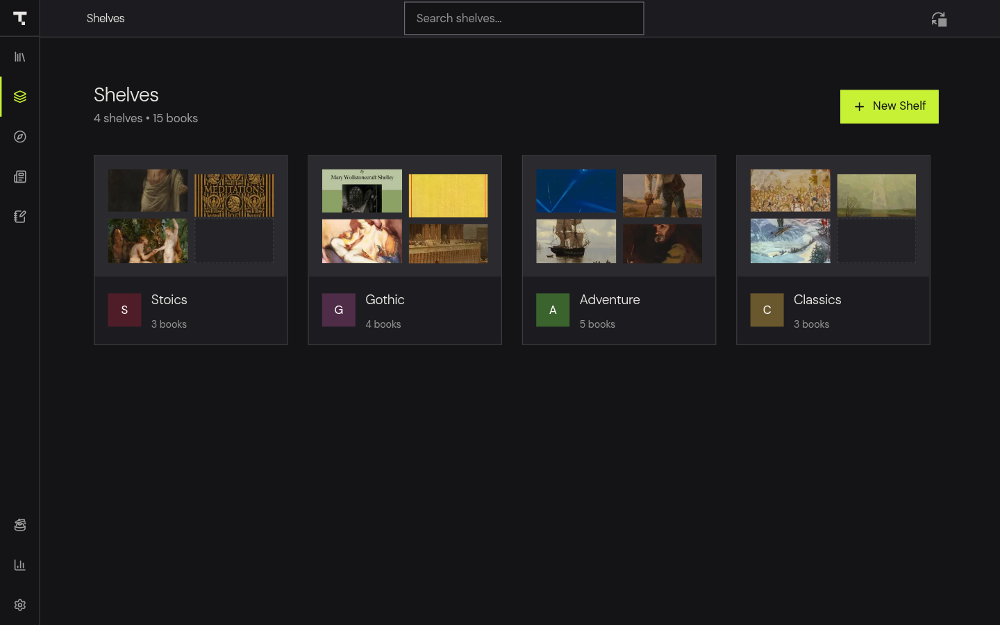

# Shelves, Smart Shelves and Series

Group books into shelves and sub-shelves, build smart shelves that fill themselves from rules, and organize your books into numbered series in Theorem.

## Create a shelf

1. Click Shelves in the sidebar, or press `Ctrl+2`.
2. Click New Shelf.
3. Enter a Name, such as "To Read" or "Sci-Fi". Add a Description if you like.
4. Click Create Shelf.

Each shelf shows a collage of its covers and a book count. A book can be on any number of shelves, and adding it to a shelf does not move or copy the file.

### Add books to a shelf

Choose whichever is easier:

- In the Library, right-click a book and choose Add to Shelf... (it reads Shelves... with a count if the book is already on shelves). Click a shelf to add the book to it. Click a checked shelf to take the book off it. The dialog stays open so you can change several shelves, and you can type a new name under Create New Shelf to make one on the spot. Smart shelves are not listed because their books come from rules.
- In the Library, click Select, select several books, and click Add to Shelf in the selection bar.
- Open a shelf and click Add Books. That takes you to the Library, where you can use the options above.

### Work inside a shelf

Click a shelf to open it. The toolbar has these buttons:

- Back to shelves
- Add Books
- Select Books, which opens a selection bar with Select All, Remove from Shelf, Add to Shelf, Mark Read or Mark Unread, Set Series, Delete and Done
- A view button that switches between grid, list and compact layouts
- Group by Series, which turns series grouping on or off for this shelf
- Create / Manage Series from Shelf

Remove from Shelf takes a book off the shelf but keeps it in your library. Delete removes the book from your library, so use it with care.

### Rename or delete a shelf

1. On the Shelves page, click the three-dot menu on a shelf.
2. Choose Edit to change its name, description, parent or smart rules, and click Save Changes.
3. Or choose Delete and confirm. The books stay in your library, and any sub-shelves become top-level shelves.

Use the search box at the top of the Shelves page to find a shelf by name.

## Nest shelves with sub-shelves

> **New in Theorem 1.6.0, not released yet.** Sub-shelves are in version 1.6.0. The latest release, 1.5.9, does not have them.

You can put shelves inside other shelves, one level deep.

1. Click New Shelf and, in the Parent shelf menu, choose the shelf that will hold the new one. Or open a top-level shelf and click New sub-shelf.
2. Name it and click Create Shelf.
3. Open the parent shelf to see its sub-shelves as buttons above the books. Click one to open it. The back button on a sub-shelf returns to its parent.

To move a shelf, choose Edit and change Parent shelf. Choose None (top-level shelf) to make it top-level again. A shelf that has sub-shelves must stay top-level. Move or promote its sub-shelves first.

Each shelf keeps its own books. A parent shelf does not automatically include the books of its sub-shelves. Deleting a parent never deletes books.

## Build a smart shelf

> **New in Theorem 1.6.0, not released yet.** Smart shelves are in version 1.6.0. The latest release, 1.5.9, does not have them.

A smart shelf fills itself with every book that matches rules you write. It updates as you import, edit or read books.

1. Click New Shelf, or choose Edit on an existing shelf.
2. Tick Smart shelf.
3. Next to Match, choose All rules (every rule must match) or Any rule (at least one must match).
4. Set up the first rule. Choose a field: Tag, Category, Author, Series, Format, Reading status or Favorite.
5. Choose Equals or Contains, then the value:
   - For Tag, Category, Author and Series, type text. Matching ignores upper and lower case. Equals matches the whole value and Contains matches part of it. For Author, each of a book's authors is checked.
   - For Format, choose a format from the list.
   - For Reading status, choose unread, reading or completed.
   - For Favorite, choose Yes or No.
6. Click Add rule to add more, up to 32 rules. Click Remove rule to delete one. A smart shelf needs at least one rule.
7. Click Create Shelf or Save Changes.

Things to know:

- You cannot add or remove books by hand in a smart shelf. Change its rules, or the books' details, instead. The Add Books button and the Remove from Shelf action are disabled.
- A book you mark read or unread by hand overrides what Theorem would infer from your progress.
- RSS articles are never included.
- Turning Smart shelf off keeps the books that currently match as an ordinary shelf. Deleting a smart shelf keeps all books.
- Smart shelves need the desktop or Android app. They are not available in the browser demo.

## Organize books into series

A series groups books by name and volume number. Theorem reads series information from EPUB metadata and from `ComicInfo.xml` inside comic files. You can also set it yourself. Volume numbers can be fractions, such as 2.5.

### Set a series for one book

1. Right-click the book, choose More..., then Edit Info.
2. Fill in Series Name and Volume / Index.
3. Click Save.

### Set a series for several books

1. In the Library, click Select and select the books. Or open a shelf and click Select Books.
2. Click Series (Set Series on a shelf). The Set Book Series window opens.
3. Enter a Series Name. Names of series you already have are suggested.
4. Under Volumes & Reading Order, give each book a Vol # or click Auto-number (1..N) to number them in order.
5. Click Save Series.

### See and read a series in order

1. Open a shelf and click Group by Series. Each series appears as its own labeled row, ordered by volume number, with the combined progress of its books.
2. When a series has an unread volume, a Continue button under the row opens the next one.
3. When you finish a book that belongs to a series, a message names the next unread volume and offers Read Next.

Books in a series without numbers are ordered by reading order instead.
